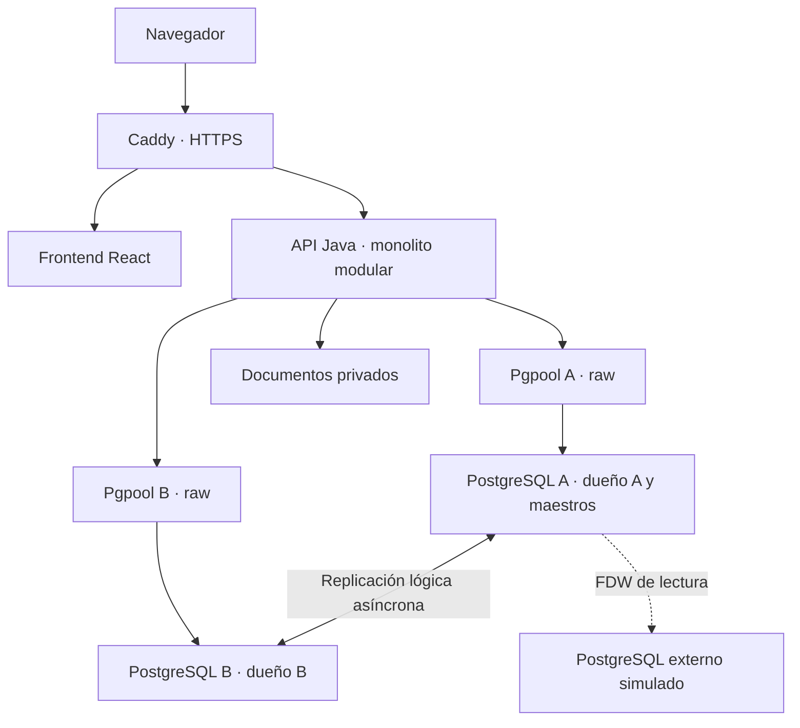

# BoviCierre

SaaS B2B (proyecto académico de **Tópicos Avanzados de Bases de Datos**, con intención comercial) para cerrar y conciliar operaciones de compraventa de ganado bovino en pie: qué animales participaron, qué peso y condiciones se pactaron, qué gastos se asignaron, cómo se calculó la liquidación y qué queda por cobrar o pagar.

> **Estado al 2026-10-10:** paquete de diseño documental (negocio, reglas, modelo conceptual y relacional en texto, arquitectura, ADR, contrato OpenAPI, plan). **No existe código, migraciones ni pruebas ejecutadas.** Láminas MER Chen y relacional en `docs/diagrams/` (pendientes de revisión humana); grafo de Graphify generado localmente (ver `docs/knowledge/graph-status.md`). Ver [`docs/status.md`](docs/status.md).

Equipo: **Aldo Fabio Contreras Marroquín** (backend, bases de datos, infraestructura) · **Jared** (frontend). Entrega académica: **31-oct-2026**. Especificación maestra: [`docs/spec/megaprompt.md`](docs/spec/megaprompt.md).

## Problema y comprador
- **Usuario**: comercializador o acopiador con 1–2 sedes, operaciones recurrentes, precio por kg o por cabeza, pagos parciales y tickets de báscula.
- **Comprador**: dueño o administrador con facultad de contratar.
- **Propuesta de valor (hipótesis)**: explicar cada liquidación y conciliar inventario, saldos y margen con la evidencia que respalda el trato.
- Segmento, precio y diferenciación son **hipótesis sin validar** ([plan de validación](docs/business/validation-plan.md)).

## Modelo de negocio
Suscripción por sede (rango a investigar MXN 2,000–4,000/mes) + configuración inicial cotizada. Sin comisión sobre ganado, sin custodia de dinero. El dinero del ganado es del cliente, no ingreso de BoviCierre. Detalle: [modelo](docs/business/business-model.md) · [economía unitaria](docs/business/unit-economics.md).

## Alcance del MVP
Incluye: empresas, sedes, usuarios y permisos; contrapartes; identificación animal, lotes y ciclos de inventario; compras/ventas MXN por kg o cabeza con condiciones versionadas; pesajes de lote o individuales; reservas contra doble venta; recepciones/entregas; gastos y asignación de costos; liquidaciones y ajustes; pagos y aplicaciones; expediente documental; reportes de margen, cartera e inventario; auditoría, respaldo, replicación M–M y FDW; simulador de margen y QR interno; OCR supervisado como extra.
Fuera: ver [ADR-012](docs/architecture/adr/ADR-012-alcance-aplazado.md) (CFDI, crédito, custodia, traspasos entre sedes, devoluciones físicas posteriores, inventario histórico, etc.).

## Requisitos académicos
| ID | Requisito | Dónde |
|---|---|---|
| AC-01 | MER | [conceptual-model](docs/database/conceptual-model.md), [relationship-matrix](docs/database/relationship-matrix.md), `docs/diagrams/` |
| AC-02 | Modelo relacional | [relational-model](docs/database/relational-model.md), [data-dictionary](docs/database/data-dictionary.md), [normalization](docs/database/normalization.md) |
| AC-03 | Usuarios, constraints, reglas | [administration](docs/database/administration.md), [business-rules](docs/domain/business-rules.md) |
| AC-04 | PL y triggers | [administration §3–4](docs/database/administration.md) |
| AC-05 | Transacciones | [administration §3](docs/database/administration.md), [overview §5–6](docs/architecture/overview.md) |
| AC-06 | Replicación M–M | [replication-and-fdw](docs/database/replication-and-fdw.md), ADR-005/006 |
| AC-07 | FDW | [replication-and-fdw §6](docs/database/replication-and-fdw.md) |
| AC-08 | Programa en Java | [overview](docs/architecture/overview.md), [oop-solid-patterns](docs/academic/oop-solid-patterns.md) |
| AC-09 | PostgreSQL y Pgpool-II | [overview §2](docs/architecture/overview.md), ADR-007 |
Matriz completa con estado: [requirements-matrix](docs/academic/requirements-matrix.md).

## Stack
Java 21 + Spring Boot 4.1.1 (Web, Validation, Security, JDBC) · Maven Wrapper · Flyway · PostgreSQL 18 + PL/pgSQL · Pgpool-II 4.7.x (raw, uno por nodo) · React + TypeScript + Vite 8 · JUnit + Testcontainers + Playwright · Docker Compose + Caddy. Versiones y fuentes: [versions.md](docs/architecture/versions.md).

## Arquitectura

Monolito modular (10 módulos), escritor exclusivo por agregado, maestros en A, cálculo monetario canónico en SQL. Detalle: [overview](docs/architecture/overview.md) · [deployment](docs/architecture/deployment.md) · [ADR](docs/architecture/adr/).

### Restricciones de la replicación (obligatorias)
- DDL, roles y secuencias no se sincronizan; migraciones coordinadas en A y B. Foreign tables, vistas y large objects no se replican como tablas.
- El apply usa `session_replication_role = replica`: no ejecuta triggers ordinarios ni verifica FK como en el escritor → se valida en origen y se concilia.
- UNIQUE/CHECK/NOT NULL pueden detener el apply por conflicto; cada error se investiga.
- No se usa `ENABLE ALWAYS` en todo el esquema (duplicaría auditoría/outbox).
- No se replican configuración de nodo, sesiones, historial de Flyway ni estado local de despacho; sólo el dueño despacha su outbox.
- Los maestros deben ser visibles en B antes de crear dependencias en B; no hay orden global entre streams.
- Folios internos pueden tener huecos y no son fiscales; UUID no da unicidad comercial a un arete.
- Pgpool raw conecta a su backend fijo; no sincroniza ni decide propietario.
- Conexiones dimensionadas: Hikari + `num_init_children`/`max_pool` + slots + administración ≤ `max_connections`.
- `origin = none` evita loops; **no** resuelve conflictos. Si el profesor exige dos escritores sobre la misma fila, se requiere otro diseño (riesgo R-01).

## Ejecución
Aún no hay código. Comandos previstos (se actualizarán con comandos verificados):
```bash
docker compose -f infra/compose/compose.academic.yml up -d   # TASK-A-011
cd backend && ./mvnw verify                                   # TASK-A-008
cd frontend && npm ci && npm run dev                          # TASK-J-004
```
Bootstrap de replicación: [runbook](docs/runbooks/bootstrap.md). Despliegue a staging pendiente de servidor (sin URL pública).

## Diagramas
- **MER completo (Chen)**: [`mer-completo.pdf`](docs/diagrams/exports/mer-completo.pdf)
- **Modelo relacional completo (pata de gallo)**: [`relacional-completo.pdf`](docs/diagrams/exports/relacional-completo.pdf)
- Láminas por dominio, fuentes editables `.drawio` y criterios de revisión: [`docs/diagrams/README.md`](docs/diagrams/README.md)

## Roles
| Producto | PostgreSQL |
|---|---|
| ADMIN, OPERADOR, CAJA, AUDITOR (por sede) | bovi_owner, bovi_migrator, bovi_command, bovi_app_a/b, bovi_auditor, bovi_repl, bovi_fdw_read, bovi_monitor, bovi_backup |

## Metodología y calendario
Kanban con WIP 1 por persona ([roadmap](docs/project/roadmap.md), [definition of done](docs/project/definition-of-done.md)).

| Fechas | Aldo | Jared | Hito |
|---|---|---|---|
| 11–13 oct | Reglas, MER, relacional, ADR, OpenAPI, grafo | Flujos, wireframes, términos | Paquete de diseño |
| 13–14 oct | Migraciones/roles, experimento M–M/FDW, auth | Proyecto frontend, mocks, sesión | Contrato y topología verificados |
| 15–18 oct | Maestros, compra, pesajes, evidencia, costo | Catálogos, ficha, captura de compra | Compra → posición → liquidación |
| 19–22 oct | Reserva, venta, pagos, ajustes, periodos | Venta, liquidación, pagos | GOLD y concurrencia |
| 23–25 oct | Reportes, auditoría, outbox, réplica/FDW | Cartera, margen, expediente, QR | Recorrido completo |
| 26–28 oct | Staging, pipeline, backups, rendimiento | Responsive, accesibilidad, E2E | Candidata + restauración |
| 29–31 oct | Correcciones, evidencia, release | Correcciones, capturas, demo | Entrega reproducible |

## Tareas
Las casillas `[ ]` de las tablas son texto (no interactivas); las listas de abajo sí lo son en GitHub. Se marcan `[x]` sólo con evidencia en [`docs/testing/evidence.md`](docs/testing/evidence.md). Detalle con evidencia: [backlog](docs/project/backlog.md).

### Aldo — backend, bases de datos e infraestructura

| Estado | ID | Tarea/entregable | Depende de | Ventana (oct) | Criterio de aceptación | Kanban |
|---|---|---|---|---|---|---|
| [ ] | TASK-A-001 | Inventario del repo/herramientas y matriz AC | Inicio | 11 | Requisitos de imagen separados de supuestos; archivos existentes respetados | Revisión |
| [ ] | TASK-A-002 | Negocio, glosario, reglas y GOLD | A-001 | 11–12 | RN completas, reconocimiento único, costos/pagos distinguibles | Revisión |
| [ ] | TASK-A-003 | MER Chen y matriz de relaciones | A-002 | 11–12 | Fuertes/débiles, rombos, óvalos, verbos, mínimos/máximos y exportaciones revisadas | Revisión |
| [ ] | TASK-A-004 | Modelo relacional, diccionario y normalización | A-003 | 12–13 | Todas las relaciones con claves, FKs, tipos, restricciones y justificación | Revisión |
| [ ] | TASK-A-005 | Arquitectura, ADR y plan de despliegue | A-002/A-004 | 12–13 | Dueños, transacciones, límites M–M y recuperación explícitos | Revisión |
| [ ] | TASK-A-006 | Contexto Markdown, README y grafo inicial | A-003/A-005/A-007 | 12–13 | Archivos sustantivos y grafo real verificado; si Graphify está bloqueado, sólo el avance documental se registra y la subtarea de grafo sigue pendiente | Revisión |
| [ ] | TASK-A-007 | OpenAPI, errores y ejemplos para Jared | A-004/A-005 | 13 | Contrato validado con decimales exactos, scope e idempotencia | Revisión |
| [ ] | TASK-A-008 | Backend modular y build reproducible | A-005/A-007 | 13–14 | Maven Wrapper, configuración por entorno y arranque verificable | Listo |
| [ ] | TASK-A-009 | DDL/Flyway, claves, índices y seed sintético | A-004 | 13–15 | Base limpia construida; restricciones fallan ante datos inválidos | Listo |
| [ ] | TASK-A-010 | Roles PostgreSQL, grants y guardas de dueño | A-009 | 13–15 | App sin privilegios administrativos; DML indebido rechazado | Backlog |
| [ ] | TASK-A-011 | Compose A/B + Pgpool y experimento M–M mínimo | A-005 y esquema mínimo aislado | 13–14 | Dos clusters escriben dueños distintos y convergen; prueba inicial no sustituye dominio definitivo | Listo |
| [ ] | TASK-A-012 | Tercero simulado y FDW sólo lectura | A-011 | 14 | Consulta real externa; escrituras rechazadas; procedencia visible | Backlog |
| [ ] | TASK-A-013 | Autenticación y permisos por sede | A-008/A-010 | 14–15 | Sesión/CSRF; pruebas 401/403 y autorización de recursos | Backlog |
| [ ] | TASK-A-014 | Maestros, animal e identificaciones centrales | A-009/A-013 | 15 | Colisión de identificador resuelta en A; B espera visibilidad | Backlog |
| [ ] | TASK-A-015 | Operaciones, lotes y versiones contractuales | A-014 | 15–16 | Borradores, selecciones únicas y condiciones versionadas | Backlog |
| [ ] | TASK-A-016 | Documentos, revisión y pesajes | A-015 | 16–17 | Archivos privados; neto/grupo reales; revisión de versión exacta | Backlog |
| [ ] | TASK-A-017 | ConfirmarCompra y asignar costo inicial | A-015/A-016 | 17–18 | Posiciones, obligación y costo inicial atómicos; componentes de compra de GOLD-01/02 y GOLD-03 completo | Backlog |
| [ ] | TASK-A-018 | Movimientos, recepción, entrega y baja | A-017 | 18–20 | Ejes físicos separados; baja conserva historia y costo | Backlog |
| [ ] | TASK-A-019 | Reservas, expiración y ConfirmarVenta | A-017/A-018 | 19–20 | Una venta ganadora en carrera; costo parcial correcto | Backlog |
| [ ] | TASK-A-020 | Pagos, anticipos y aplicaciones | A-017/A-019 | 20–21 | Sumatorias bajo lock, mismo scope, idempotencia y GOLD-04 | Backlog |
| [ ] | TASK-A-021 | Ajustes, reversos y reembolsos | A-020 | 21–22 | GOLD-07; ninguna sobreaplicación o borrado de originales | Backlog |
| [ ] | TASK-A-022 | Costo tardío, valoración y periodos | A-019/A-021 | 21–23 | GOLD-06/08/10; cierre conserva versiones y concilia | Backlog |
| [ ] | TASK-A-023 | Auditoría, outbox/inbox y reintentos | A-017..A-022 | 22–24 | Hecho y evento atómicos; consumidor no duplica al reintentar | Backlog |
| [ ] | TASK-A-024 | Consultas de cartera, margen e inventario | A-020/A-022 | 23–24 | Totales reconciliados, corte visible y EXPLAIN documentado | Backlog |
| [ ] | TASK-A-025 | Integrar aceptación de fuente FDW y QR | A-012/A-016 | 23–25 | Snapshot local de tarifa/ticket; QR con acceso autorizado | Backlog |
| [ ] | TASK-A-026 | Pruebas M–M completas, fallas y conciliación | A-009/A-011/A-023 | 24–25 | Partición/reconexión del esquema definitivo, sin loops ni auditoría duplicada, sin redirigir dueño | Backlog |
| [ ] | TASK-A-027 | Pruebas acumulativas de dominio/SQL/API y concurrencia | Incremental por módulo; cierre tras A-026 | 18–27 | Escenarios TEST, GOLD integrales y PostgreSQL real; no posponer pruebas hasta el final | Backlog |
| [ ] | TASK-A-028 | Pipeline, staging, TLS y configuración | A-008/A-011 | 26–27 | Checkout limpio desplegable y smoke test; secretos externos | Backlog |
| [ ] | TASK-A-029 | Respaldo, restauración y runbooks | A-026/A-028 | 26–28 | Restauración aislada cronometrada con cifras y archivos conciliados | Backlog |
| [ ] | TASK-A-030 | Rendimiento, conexiones y observabilidad | A-024/A-028 | 27–28 | Carga/dataset declarados; límites y resultados auténticos | Backlog |
| [ ] | TASK-A-031 | OCR supervisado si se aprueba el núcleo | A-016/A-027 | 25–28 opcional | Propuesta revisable, sin confirmar importes automáticamente | Backlog |
| [ ] | TASK-A-032 | Dossier académico, manual SQL y exposición | A-027..A-030 | 29–31 | Cada AC enlaza artefacto y demo ejecutada | Backlog |
| [ ] | TASK-A-033 | Fuentes, README y Graphify final consolidado | A-032/J-022 | 29–31 | Trazabilidad de ambos, casillas con evidencia, grafo sobre revisión integrada y release verificable | Backlog |

### Jared — frontend e integración de experiencia

| Estado | ID | Tarea/entregable | Depende de | Ventana (oct) | Criterio de aceptación | Kanban |
|---|---|---|---|---|---|---|
| [ ] | TASK-J-001 | Entender negocio, actores y términos | A-002 | 11–12 | Flujos y preguntas documentados; distingue operación/pago/entrega | Listo |
| [ ] | TASK-J-002 | Wireframes y arquitectura de información | J-001/A-003 | 11–12 | Recorrido compra→venta→liquidación→pago y excepciones | Listo |
| [ ] | TASK-J-003 | Tokens y componentes visuales accesibles | J-002 | 12–14 | Tablas, formularios, feedback y jerarquía consistentes | Backlog |
| [ ] | TASK-J-004 | React/TS/Vite, router y build | A-007/J-003 | 13–14 | Proyecto reproducible y separación por funciones | Backlog |
| [ ] | TASK-J-005 | Cliente tipado, mocks y errores del contrato | A-007/J-004 | 13–14 | Mocks identificados; formato decimal y 401/403/409/422/503 | Backlog |
| [ ] | TASK-J-006 | Sesión, navegación y sede autorizada | A-013/J-005 | 14–15 | Cookie/CSRF integrados; permiso denegado sin revelar datos | Backlog |
| [ ] | TASK-J-007 | Contrapartes y predios | A-014/J-006 | 15–16 | Captura/búsqueda/paginación con validación | Backlog |
| [ ] | TASK-J-008 | Ficha animal, ciclos e inventario | A-014/A-017 | 16–18 | Identidad permanente, posiciones históricas y disponibilidad claras | Backlog |
| [ ] | TASK-J-009 | Captura de compra y condiciones por lote | A-015/J-007 | 16–18 | Borrador por pasos; precio por kg/cabeza y versión | Backlog |
| [ ] | TASK-J-010 | Pesajes, archivos y revisión | A-016/J-009 | 17–18 | Conjunto, unidad, evidencia, incompatibilidad y corrección visibles | Backlog |
| [ ] | TASK-J-011 | Selección de venta y reservas | A-019/J-008 | 19–20 | Expiración/conflicto real y recarga sin doble confirmación | Backlog |
| [ ] | TASK-J-012 | Simulador y detalle explicable de liquidación | A-019/J-010 | 19–21 | Fórmula, costos, ajustes, saldo y estado de entrega separados | Backlog |
| [ ] | TASK-J-013 | Cobros/pagos y aplicación guiada | A-020/J-012 | 20–22 | Anticipo, disponible y saldos correctos; reintento seguro | Backlog |
| [ ] | TASK-J-014 | Ajustes, devoluciones de dinero y periodos | A-021/A-022 | 21–23 | Motivo, autorización y versiones; muestra GOLD-07 sin ambigüedad | Backlog |
| [ ] | TASK-J-015 | Recepciones, entregas y expediente temporal | A-018/A-023 | 22–24 | Eventos verificables, documentos privados y estados físicos claros | Backlog |
| [ ] | TASK-J-016 | Cartera, margen y QR interno | A-024/A-025 | 23–25 | Datos reales de API, corte/provisionalidad y navegación autorizada | Backlog |
| [ ] | TASK-J-017 | Estados de fuente caída/sincronización/conflicto | A-026/J-016 | 24–26 | Mensajes accionables; nunca confirma una escritura fallida | Backlog |
| [ ] | TASK-J-018 | Responsive, teclado y accesibilidad | J-006..J-017 | 25–28 | Flujo principal usable en móvil y teclado, sin cortes de información | Backlog |
| [ ] | TASK-J-019 | Pruebas E2E integradas con Aldo | Recorrido con API real/J-017; coordina A-027 | 26–28 | Compra/venta/pago, errores y permisos con backend real | Backlog |
| [ ] | TASK-J-020 | UI de OCR sólo si el extra está implementado | A-031/J-010 | 25–28 opcional | Datos propuestos y revisión humana obligatoria | Backlog |
| [ ] | TASK-J-021 | Manual, capturas auténticas y demo | J-018/J-019 | 29–31 | Recorrido reproducible, sin pantallas ficticias presentadas como integración | Backlog |
| [ ] | TASK-J-022 | README, contexto frontend y actualización de grafo | J-021 | 29–31 | Pantallas→API→reglas enlazadas y evidencia lista; A-033 consolida después el grafo final | Backlog |

### Listas por responsable

**Aldo**

- [ ] TASK-A-001 — Inventario del repo/herramientas y matriz AC
- [ ] TASK-A-002 — Negocio, glosario, reglas y GOLD
- [ ] TASK-A-003 — MER Chen y matriz de relaciones
- [ ] TASK-A-004 — Modelo relacional, diccionario y normalización
- [ ] TASK-A-005 — Arquitectura, ADR y plan de despliegue
- [ ] TASK-A-006 — Contexto Markdown, README y grafo inicial
- [ ] TASK-A-007 — OpenAPI, errores y ejemplos para Jared
- [ ] TASK-A-008 — Backend modular y build reproducible
- [ ] TASK-A-009 — DDL/Flyway, claves, índices y seed sintético
- [ ] TASK-A-010 — Roles PostgreSQL, grants y guardas de dueño
- [ ] TASK-A-011 — Compose A/B + Pgpool y experimento M–M mínimo
- [ ] TASK-A-012 — Tercero simulado y FDW sólo lectura
- [ ] TASK-A-013 — Autenticación y permisos por sede
- [ ] TASK-A-014 — Maestros, animal e identificaciones centrales
- [ ] TASK-A-015 — Operaciones, lotes y versiones contractuales
- [ ] TASK-A-016 — Documentos, revisión y pesajes
- [ ] TASK-A-017 — ConfirmarCompra y asignar costo inicial
- [ ] TASK-A-018 — Movimientos, recepción, entrega y baja
- [ ] TASK-A-019 — Reservas, expiración y ConfirmarVenta
- [ ] TASK-A-020 — Pagos, anticipos y aplicaciones
- [ ] TASK-A-021 — Ajustes, reversos y reembolsos
- [ ] TASK-A-022 — Costo tardío, valoración y periodos
- [ ] TASK-A-023 — Auditoría, outbox/inbox y reintentos
- [ ] TASK-A-024 — Consultas de cartera, margen e inventario
- [ ] TASK-A-025 — Integrar aceptación de fuente FDW y QR
- [ ] TASK-A-026 — Pruebas M–M completas, fallas y conciliación
- [ ] TASK-A-027 — Pruebas acumulativas de dominio/SQL/API y concurrencia
- [ ] TASK-A-028 — Pipeline, staging, TLS y configuración
- [ ] TASK-A-029 — Respaldo, restauración y runbooks
- [ ] TASK-A-030 — Rendimiento, conexiones y observabilidad
- [ ] TASK-A-031 — OCR supervisado si se aprueba el núcleo
- [ ] TASK-A-032 — Dossier académico, manual SQL y exposición
- [ ] TASK-A-033 — Fuentes, README y Graphify final consolidado

**Jared**

- [ ] TASK-J-001 — Entender negocio, actores y términos
- [ ] TASK-J-002 — Wireframes y arquitectura de información
- [ ] TASK-J-003 — Tokens y componentes visuales accesibles
- [ ] TASK-J-004 — React/TS/Vite, router y build
- [ ] TASK-J-005 — Cliente tipado, mocks y errores del contrato
- [ ] TASK-J-006 — Sesión, navegación y sede autorizada
- [ ] TASK-J-007 — Contrapartes y predios
- [ ] TASK-J-008 — Ficha animal, ciclos e inventario
- [ ] TASK-J-009 — Captura de compra y condiciones por lote
- [ ] TASK-J-010 — Pesajes, archivos y revisión
- [ ] TASK-J-011 — Selección de venta y reservas
- [ ] TASK-J-012 — Simulador y detalle explicable de liquidación
- [ ] TASK-J-013 — Cobros/pagos y aplicación guiada
- [ ] TASK-J-014 — Ajustes, devoluciones de dinero y periodos
- [ ] TASK-J-015 — Recepciones, entregas y expediente temporal
- [ ] TASK-J-016 — Cartera, margen y QR interno
- [ ] TASK-J-017 — Estados de fuente caída/sincronización/conflicto
- [ ] TASK-J-018 — Responsive, teclado y accesibilidad
- [ ] TASK-J-019 — Pruebas E2E integradas con Aldo
- [ ] TASK-J-020 — UI de OCR sólo si el extra está implementado
- [ ] TASK-J-021 — Manual, capturas auténticas y demo
- [ ] TASK-J-022 — README, contexto frontend y actualización de grafo


## Documentación
| Área | Archivos |
|---|---|
| Negocio | [business-model](docs/business/business-model.md) · [validation-plan](docs/business/validation-plan.md) · [unit-economics](docs/business/unit-economics.md) |
| Dominio | [glossary](docs/domain/glossary.md) · [business-rules](docs/domain/business-rules.md) · [use-cases](docs/domain/use-cases.md) · [states-and-calculations](docs/domain/states-and-calculations.md) |
| Investigación | [sources](docs/research/sources.md) · [evidence-register](docs/research/evidence-register.md) · [theoretical-foundation](docs/research/theoretical-foundation.md) |
| Datos | [conceptual](docs/database/conceptual-model.md) · [relaciones](docs/database/relationship-matrix.md) · [relacional](docs/database/relational-model.md) · [diccionario](docs/database/data-dictionary.md) · [normalización](docs/database/normalization.md) · [administración](docs/database/administration.md) · [replicación y FDW](docs/database/replication-and-fdw.md) |
| Arquitectura | [overview](docs/architecture/overview.md) · [deployment](docs/architecture/deployment.md) · [versions](docs/architecture/versions.md) · [ADR](docs/architecture/adr/) |
| API / UI | [openapi.yaml](docs/api/openapi.yaml) · [flows-and-screens](docs/ui/flows-and-screens.md) |
| Proyecto | [roadmap](docs/project/roadmap.md) · [backlog](docs/project/backlog.md) · [DoD](docs/project/definition-of-done.md) · [riesgos](docs/project/risks.md) |
| Operación | [runbooks](docs/runbooks/) |
| Pruebas | [test-plan](docs/testing/test-plan.md) · [demo-script](docs/testing/demo-script.md) · [evidence](docs/testing/evidence.md) |
| Contexto | [traceability](docs/traceability.md) · [status](docs/status.md) · [graphify-workflow](docs/knowledge/graphify-workflow.md) · [graph-status](docs/knowledge/graph-status.md) |

## Datos y privacidad
Todos los datos de ejemplo son **sintéticos**. No se suben datos reales de clientes, documentos oficiales ni credenciales al repositorio, demos, logs ni grafo.
