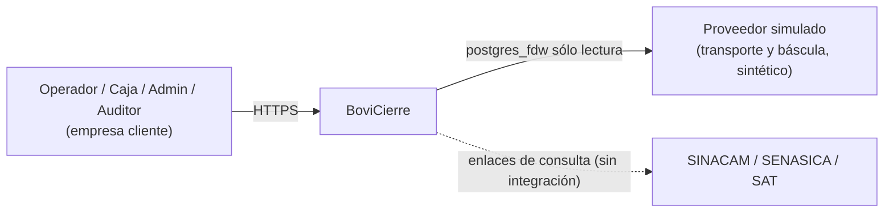
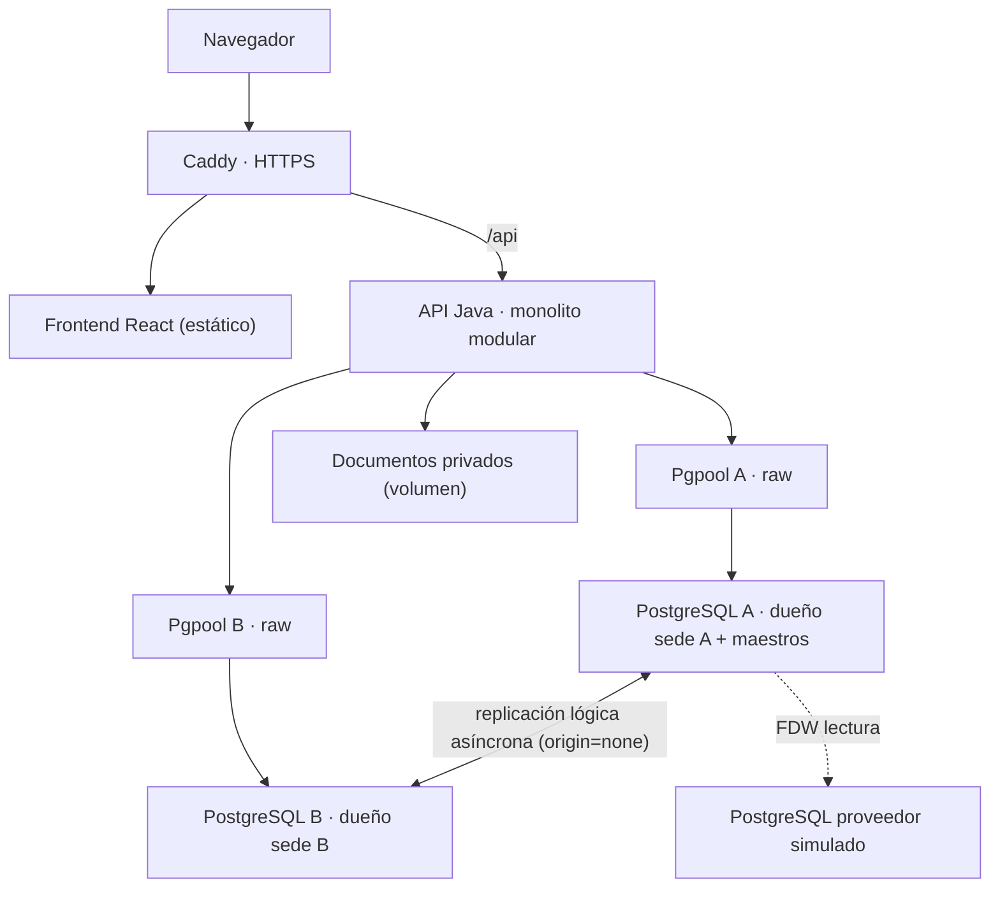

# Arquitectura

Estado: diseñado. Decisiones en `adr/`. Versiones en `versions.md`.

## 1. Contexto


## 2. Contenedores

La replicación va PostgreSQL ↔ PostgreSQL, no por Pgpool. Cada PostgreSQL es un cluster separado con su volumen.

## 3. Módulos del monolito (`backend/src/main/java/mx/bovicierre/<modulo>`)
| # | Módulo | Paquete | Responsabilidad | Tablas que escribe |
|---|---|---|---|---|
| 1 | Acceso y organización | `acceso` | Sesión, sedes, membresías | usuario, membresia_usuario |
| 2 | Contrapartes y establecimientos | `contrapartes` | Parte, predio | parte, predio |
| 3 | Identidad animal | `identidad` | Alta y códigos en A | animal, animal_identificacion |
| 4 | Inventario | `inventario` | Posiciones, reservas, movimientos | posicion_inventario, reserva_venta, movimiento_inventario |
| 5 | Operaciones y contratos | `operaciones` | Borradores, lotes, versiones, confirmación | operacion, lote, contrato_version, condicion_lote, selecciones |
| 6 | Pesajes y evidencia | `evidencia` | Pesajes, documentos, revisiones | pesaje, documento, revision_* |
| 7 | Liquidaciones, costos y periodos | `liquidaciones` | Liquidación, gastos, asignaciones, asientos, cierres | liquidacion, gasto, asignacion, asiento, periodo |
| 8 | Pagos y cartera | `pagos` | Pagos, aplicaciones, reversos | pago, aplicacion_pago |
| 9 | Reportes e integraciones | `reportes`, `integraciones` | Cartera, margen, FDW, outbox dispatcher | infra.entrega_outbox |
| 10 | Auditoría y operación | `operacion_tecnica` | Conciliación, estado de réplica | — |
Cada módulo: `domain/` (value objects, estados), `application/` (casos de uso + puertos), `adapters/in/web`, `adapters/out/jdbc`. `shared/` sólo tipos pequeños (Money, PesoKg, ids). Un módulo no usa los adaptadores de otro: llama su puerto.

## 4. Enrutamiento por propietario
1. El controlador recibe la sede solicitada; `application` verifica membresía.
2. `OwnerDatabaseRouter.resolver(tipoAgregado, empresa, sede)` → `Nodo.A | Nodo.B` (maestros siempre A; locales según `sucursal.nodo_dueno`).
3. `BranchTransactionRunner.ejecutar(nodo, callback)` usa el `TransactionTemplate` + `JdbcTemplate` del DataSource de ese nodo durante todo el caso de uso. No hay `AbstractRoutingDataSource` que cambie a mitad de transacción ni `ChainedTransactionManager`.
4. Si el nodo no responde → 503 `BV501`. No hay failover al otro nodo.
5. Alta de identidad para B: comando en A → estado PENDIENTE_CONVERGENCIA → el cliente reintenta la operación en B cuando la identidad es visible.

## 5. Secuencia ConfirmarVenta
```mermaid
sequenceDiagram
    participant UI
    participant API
    participant R as OwnerDatabaseRouter
    participant DB as PostgreSQL dueño (B)
    UI->>API: POST /api/v1/operaciones/{id}/confirmar (Idempotency-Key, If-Match)
    API->>API: autorizar sesión/sede/rol
    API->>R: resolver(VENTA, E, S)
    R-->>API: Nodo B
    API->>DB: BEGIN
    API->>DB: SELECT cmd_confirmar_venta(...)
    DB->>DB: reclamar clave idempotente
    DB->>DB: FOR UPDATE periodo → operación → posiciones(id asc) → reservas
    DB->>DB: validar version_lock, condiciones, pesajes, reservas vigentes
    DB->>DB: liquidación + conceptos, asientos VENTA, posiciones VENDIDA_PENDIENTE_ENTREGA, reservas CONSUMIDA
    DB->>DB: auditoria_evento + evento_outbox + resultado en clave
    API->>DB: COMMIT
    API-->>UI: 200 {liquidacion_id, total, ...}
    Note over API,DB: Cualquier error → ROLLBACK total; 40001/40P01 → reintento acotado con la misma clave
```

## 6. Secuencia AplicarPago
```mermaid
sequenceDiagram
    participant UI
    participant API
    participant DB as PostgreSQL dueño
    UI->>API: POST /api/v1/pagos/{id}/aplicaciones (Idempotency-Key)
    API->>DB: BEGIN; SELECT cmd_aplicar_pago(...)
    DB->>DB: reclamar clave; FOR UPDATE periodo; FOR UPDATE pagos (id asc); FOR UPDATE liquidaciones (id asc)
    DB->>DB: verificar E/S/parte/moneda/dirección; Σ ≤ disponible; Σ ≤ saldo
    DB->>DB: INSERT aplicacion_pago; auditoría; outbox
    API->>DB: COMMIT
    API-->>UI: 201 {disponible, saldos}
```

## 7. Topología de despliegue
Ver `deployment.md`.
